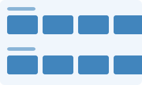
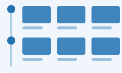
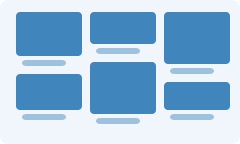
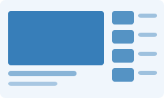
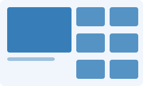
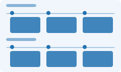

# Videoteca: plugin de WordPress para vídeos de YouTube

Aquí se publican los ZIP instalables de **Videoteca**. El código fuente está en un repositorio privado y las versiones se publican solas desde allí: no subas archivos aquí a mano.

**Descargar:** [última versión](https://github.com/marlop-sergio/wp-videogallery-releases/releases/latest). Descarga el archivo `wp-videogallery-X.Y.Z.zip`, no el «Source code».

---

## Qué hace

- Sincroniza los vídeos de tu canal de YouTube según un horario: más a menudo en horario laboral y nada de noche.
- Los organiza con **etiquetas** propias, puestas a mano o con reglas automáticas.
- Los muestra en **galerías** (feeds) con 7 visualizaciones: Carriles, Cronología, Muro mixto, Escenario, Mosaico, Vertical (Shorts) e Itinerario.
- Una **página resumen** con el último vídeo de cada galería.
- Los vídeos se reproducen **dentro de la web**. El reproductor de YouTube (modo `youtube-nocookie`) solo se carga al pulsar, y las miniaturas se sirven desde tu propia web.
- Sin plugins ni librerías de terceros.

## Las ocho visualizaciones

| | | |
|:---:|:---:|:---:|
| <br>**Carriles**<br>Una fila deslizable por etiqueta | <br>**Cronología**<br>Agrupados por mes en una línea de tiempo | <br>**Muro mixto**<br>Tarjetas con texto en columnas |
| <br>**Escenario**<br>Un vídeo grande y «A continuación» | <br>**Mosaico**<br>Portada: uno grande y los demás alrededor | <br>**Vertical**<br>Solo Shorts, en formato 9:16 |
| <br>**Itinerario**<br>Capítulos numerados con progreso | <br>**Líneas de tiempo**<br>Una línea horizontal por lista de YouTube | |

## Instalar

1. **Plugins → Añadir nuevo → Subir plugin** → elige el ZIP → **Instalar ahora** → **Activar**.
2. Si ya tenías una versión anterior, WordPress pregunta qué hacer: elige **Reemplazar la actual con la subida**. Los ajustes, vídeos y galerías se conservan.

**Actualizar:** desde la versión 0.4.0 no hace falta repetir esto. Cada web comprueba las versiones nuevas y las ofrece en *Plugins* con **Actualizar ahora**. Si activas *Activar actualizaciones automáticas* en la fila del plugin, se instalan solas.

## Configurar (una vez por web)

### 1. Clave de API de YouTube (gratis, 5 minutos)

Con la cuenta de Google propietaria del canal:

1. Entra en <https://console.cloud.google.com/> → selector de proyectos → **Nuevo proyecto** (por ejemplo `videoteca-web`).
2. **APIs y servicios → Biblioteca** → `YouTube Data API v3` → **Habilitar**.
3. **APIs y servicios → Credenciales → Crear credenciales → Clave de API**. Copia la clave, que empieza por `AIza…`.
4. **Editar clave** → *Restricciones de API* → solo **YouTube Data API v3**. Opcionalmente, *Restricciones de aplicación* → **Direcciones IP** del servidor. Si te equivocas de IP, el plugin te dice cuál debes poner.

No hace falta OAuth, ni pantalla de consentimiento, ni tarjeta de crédito.

### 2. Ajustes → Videoteca

1. Pega la **clave de API** y el **canal**: `@handle`, el ID `UC…` o la URL del canal.
2. **Guardar cambios** → **Probar conexión** (al final de la página) → **Sincronizar ahora**.
3. Opcional: ajusta la rejilla de horarios, las reglas de etiquetas y los avisos por correo.

### 3. Sincronización automática

WordPress sincroniza sola cuando hay visitas. Para que se cumpla el horario con exactitud, crea en el panel del hosting (*Tareas programadas / Cron jobs*) una tarea cada 15 minutos:

```
curl -s https://TU-DOMINIO/wp-cron.php?doing_wp_cron >/dev/null
```

Si el hosting no tiene tareas programadas, sirve un servicio gratuito como cron-job.org que visite esa dirección cada 15 minutos.

## Crear galerías

1. **Etiquetas:** pónselas a los vídeos en **YouTube** y elige en *Ajustes → Videoteca → Etiquetado automático* si se **importan todas** solas (con una lista de las que ignorar) o solo las que crees en *Videoteca → Etiquetas*. También puedes añadir etiquetas propias a mano en *Videoteca → Vídeos*. La estrella ★ marca los destacados.
2. **Videoteca → Feeds → Añadir feed:** elige las etiquetas, el número de vídeos, el orden, el formato y la visualización (con un esquema de cada una). Al guardar, se ve una **vista previa** con tus vídeos.
3. **¿Ya tienes las listas organizadas en YouTube?** En el feed, pega la URL de una **lista de reproducción** de tu canal y elige *Orden: el de la lista de YouTube*. El feed muestra esa lista en su orden y cambia solo cuando la editas en YouTube Studio.

## Una página índice con una línea por evento

Por ejemplo, `/videos` con una línea de tiempo por evento y, al pulsar, `/videos/ibiza-2026` con todos los vídeos de ese evento:

1. Crea un feed por evento con su **lista de reproducción** (vista Mosaico o Muro).
2. Crea un feed «Vídeos» con la vista **Líneas de tiempo** y, en **Listas de reproducción por filas**, una lista por línea (`Título | URL`, o solo la URL).
3. *Crear página* en el feed «Vídeos» y luego en cada feed de evento: las de evento se crean dentro de «Vídeos» (`/videos/ibiza-2026`), y cada línea de `/videos` enlaza a la suya.

Para mostrar **todo, por grupos, del más reciente al más antiguo** sin tener que mantenerlo: en el feed «Vídeos» marca **Incluir todas las listas públicas del canal**, elige **Orden de las filas → La del vídeo más reciente primero** y **Orden → Más recientes primero**, y sube **Vídeos por fila** (hasta 200). Si quieres, añade la fila **«Otros vídeos»** con los que no están en ninguna lista.

## Mostrarlas en la web

**Lo más rápido:** en *Videoteca → Feeds*, la columna **En uso en** muestra dónde aparece cada galería. Si pone *Sin usar*, pulsa **Crear página**: se crea un borrador con el mismo nombre y la galería ya puesta.

**Con el editor de bloques:** **+** → busca **Videoteca** (una galería) o **Videoteca: resumen de galerías**.

**Con Elementor:** panel de widgets → categoría **Videoteca** → arrastra **Videoteca** o **Videoteca: resumen** y elige el feed y la vista en sus ajustes.

**Con Divi:** añadir módulo → busca **Videoteca** o **Videoteca: resumen**.

**Con shortcode** (vale para Elementor, el editor clásico, widgets…):

```text
[videoteca feed="ibiza-2026"]                              ← la galería con su vista por defecto
[videoteca feed="ibiza-2026" vista="mosaico"]              ← la misma galería con otra vista
[videoteca etiquetas="webinar" vista="carriles" limite="12"]  ← sin crear feed, por etiqueta
[videoteca vista="vertical"]                               ← todos los Shorts del canal
[videoteca feed="curso" vista="itinerario"]                ← serie con capítulos y progreso
[videoteca lista="https://www.youtube.com/playlist?list=PL…" vista="itinerario"]  ← una lista de YouTube, en su orden
[videoteca_resumen]                                        ← último vídeo de cada galería
[videoteca_resumen feeds="ibiza-2026,webinars" sin_repetir="si"]
```

| Atributo de `[videoteca]` | Valores |
|---|---|
| `feed` | nombre corto (slug) del feed; aparece en la caja «Cómo insertarlo» del feed |
| `vista` | `carriles`, `cronologia`, `muro`, `escenario`, `mosaico`, `vertical`, `itinerario`, `lineas` |
| `etiquetas` | lista separada por comas |
| `limite` | 1–200 |
| `orden` | `date_desc`, `date_asc`, `title`, `manual` |
| `reproductor` | `auto`, `modal`, `inline` |
| `lista` | URL o ID de una lista de reproducción de tu canal |

| Atributo de `[videoteca_resumen]` | Valores |
|---|---|
| `feeds` | slugs separados por comas; vacío = todas |
| `orden` | `reciente`, `alfabetico`, `lista` |
| `nuevo` | días con la marca «Nuevo» (7 por defecto; `0` la quita) |
| `sin_repetir` | `si` para no repetir el mismo vídeo en varias tarjetas |

## Ajustar el diseño al tema

Los estilos heredan la tipografía y los colores del tema. Para cambiar los colores (títulos, textos, fechas, acento, fondo de las tarjetas):

- **Toda la web:** *Ajustes → Videoteca → Colores*.
- **Elementor:** pestaña **Estilo** del widget Videoteca (incluye la tipografía de los títulos).
- **Divi:** grupo **Colores** del módulo Videoteca.

Para el redondeo o la separación, añade en *Apariencia → Personalizar → CSS adicional*:

```css
.wpvg { --wpvg-accent: #c8102e; --wpvg-radius: 6px; --wpvg-gap: 20px; }
```

## Si algo falla

- **«Google rechaza la petición…»:** revisa las restricciones de la clave; el mensaje indica la IP que hay que autorizar.
- **No entran vídeos nuevos:** mira *Ajustes → Videoteca → Registro* y *Herramientas → Salud del sitio*. Si la sincronización falla 3 veces seguidas, el plugin avisa por correo.
- **Un vídeo no aparece:** en YouTube Studio debe ser público y tener activado *Permitir inserción*.
